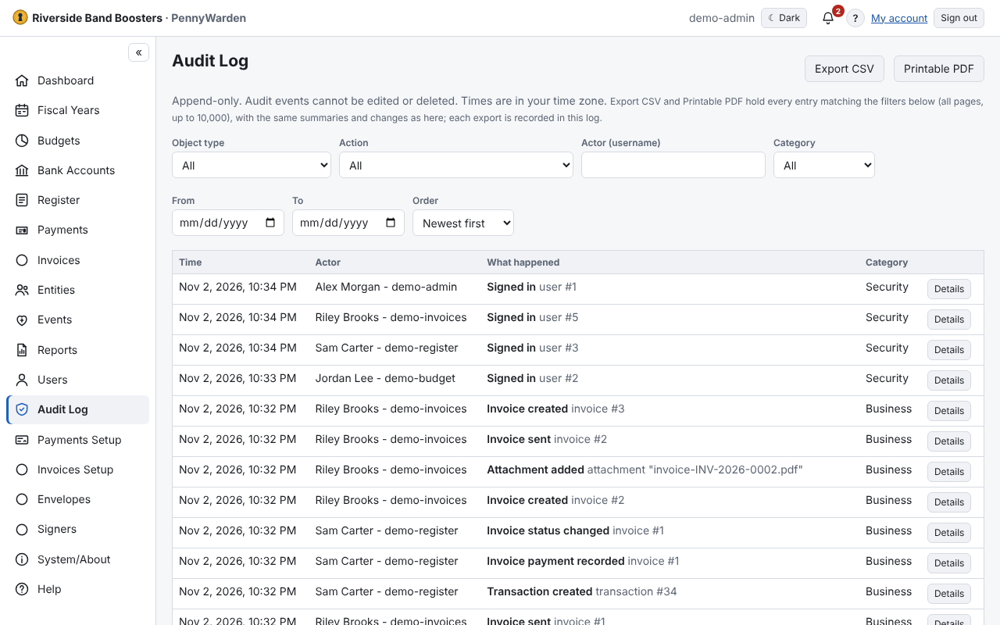

Every change in PennyWarden is recorded: who, when, what and which record, with the values before and after. Entries
read in plain words; **Details** shows what changed.
- Filter by date, category, user, action or record type.
- **Export CSV** or **Printable PDF** for an audit review.

The log can't be edited or deleted. Account numbers and passwords never appear in it, and Administrators' views and
exports leave out financial content. Administrators and Auditors can open it.
