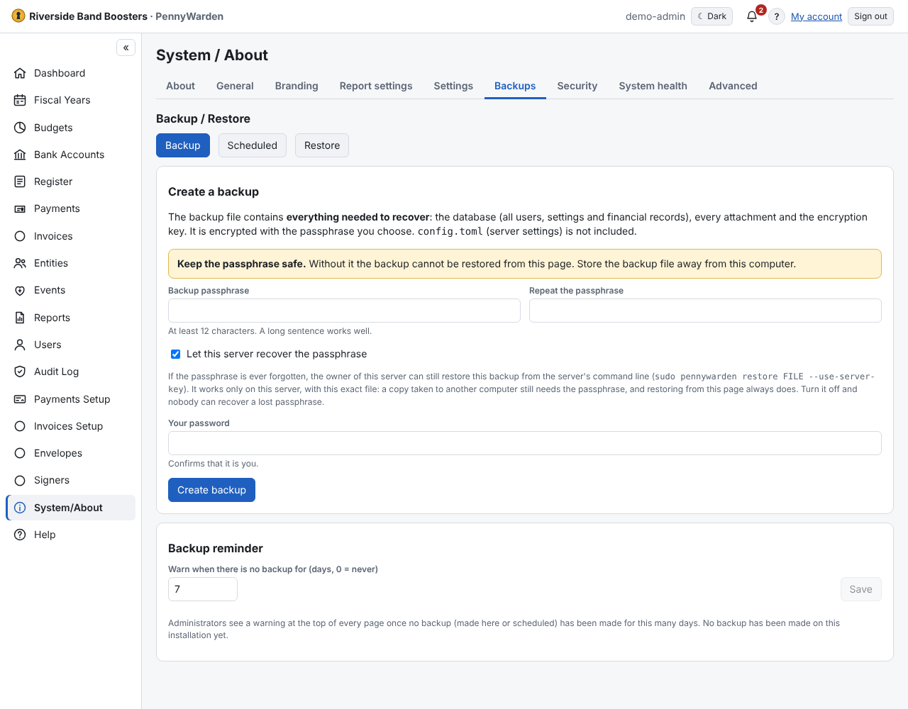

A backup holds the database, the attachments and what is needed to decrypt account numbers.

**Make a backup now**
1. **System/About → Backups**.
2. Enter a passphrase of at least 12 characters and your password.
3. **Create backup**. Keep the file away from the computer and the passphrase somewhere safe.

With **Let this server recover the passphrase**, the server's owner can restore it from the command line even if the
passphrase is lost.

**Scheduled backups**: **Back up automatically** daily or weekly to a folder, with how many to keep. If a backup fails,
PennyWarden retries (1 hour, 2, 4 …) and shows a banner to Administrators. On a local install you are responsible for
keeping backups somewhere other than the computer itself.

The full guide is [Backup and restore](../reference/backup-restore.md).
