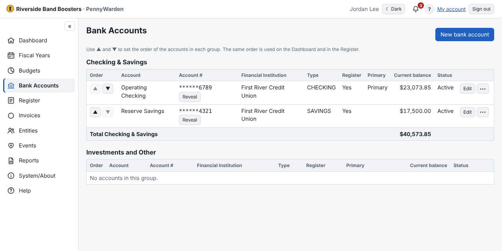

Accounts are listed in two groups, **Checking & Savings** and **Investments and Other**, each with the total of its
active accounts.

1. **New bank account**.
2. Enter the name and choose the **Financial Institution** (only Entities marked as a Financial Institution are offered;
   **+ New institution** adds one).
3. Choose the type and subtype and enter the full account number. Optional: interest rate and notes.
4. **Checking and Savings** use a **register** by default; investments don't. You can change that.
5. A register account needs its **opening balance** and **opening balance date** — where its reliable history starts.
6. **Account opened** (optional): the date an account was really opened after PennyWarden was set up.

The account number is stored encrypted and must be unique. Everyone sees it masked, e.g. `******1234`; **Reveal**
(Budget Managers only) shows it in full and is recorded in the Audit Log. **Make primary** chooses the account the
Register opens on. **▲ / ▼** in the *Order* column set the order used everywhere.
