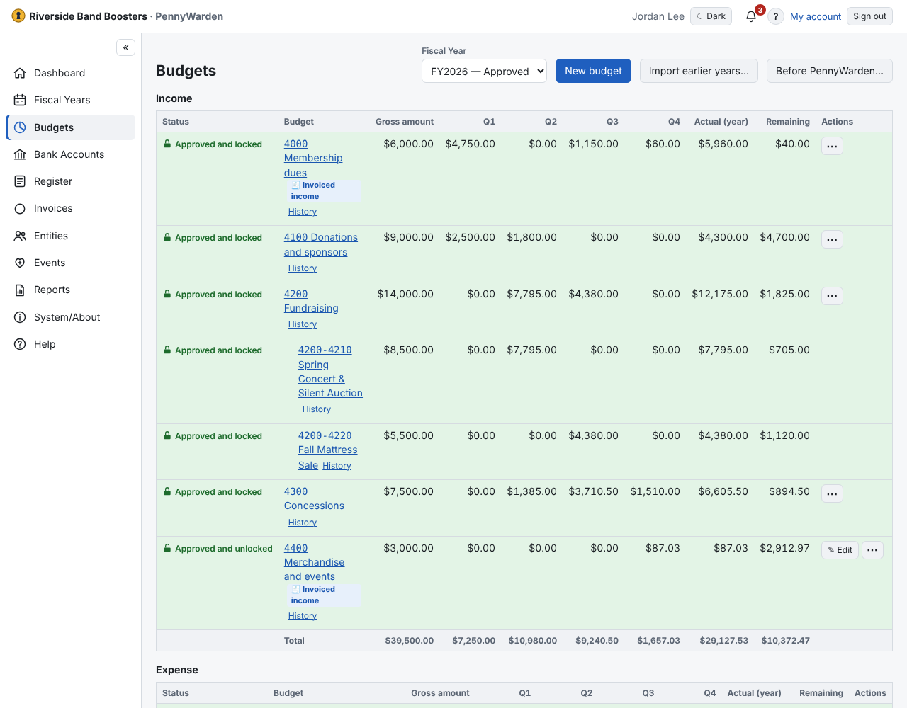

Every budget belongs to one Fiscal Year and is either **Income** or **Expense**. Choose the year at the top of the page;
Draft, Approved and Closed years are all listed.

**Codes, sub-budgets and Other**
- A simple budget is shown by its code and name: **1000 Operations**.
- A budget can have sub-budgets: **1000-01 Travel**. The parent then becomes a roll-up and can't receive transactions
  itself; you allocate to its sub-budgets.
- Every parent has a system-managed **Other** sub-budget: *Other = parent amount − the sub-budgets*. You never edit it.
  When Other is $0.00 it is hidden; when it becomes positive again it reappears.
- Sub-budgets together can't exceed the parent's amount.

**Amounts are gross.** A budget's amount and its actual are gross: a reimbursement is recorded in an income budget, so
it doesn't reduce the expense budget's actual. An expense budget can look over budget even when the net cost was within
plan. **Remaining** can go negative — a budget never stops a transaction. An income budget that receives more than
planned shows the extra in green, e.g. **+$250.00 above budget**.

**Status marks**

| Mark | Status | Background |
|---|---|---|
| **?** | Draft | light yellow |
| closed padlock | Approved and locked | light green |
| open padlock | Approved and unlocked | light green |
| **X** | Rejected | light red |
