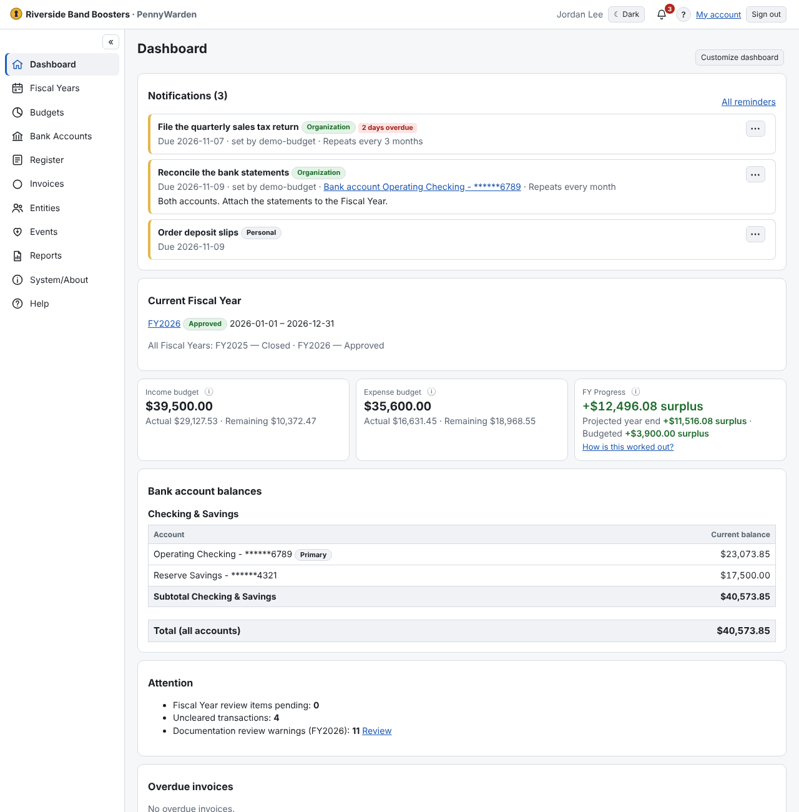

For financial users the Dashboard shows:
- the **current Fiscal Year** and its status;
- **income and expense** budget totals (the **ⓘ** explains that budget amounts are
  [gross](../budgets/about-budgets.md)) and **FY Progress**: the result so far (surplus or deficit), the projected
  year end and the budgeted result — see [How the budget figures are worked out](dashboard-figures.md);
- **bank account balances** in two groups — *Checking & Savings* and *Investments and Other* — each with a subtotal,
  then the total of all accounts;
- **attention items**: Fiscal Year reviews, missing documentation, due reminders and overdue invoices;
- **charts** for the selected Fiscal Year: income by budget, monthly income and expenses, budgeted vs spent, month-end
  bank balances, expenses by budget and cumulative net. Hover a chart for exact amounts or open **Show data table**.
  Voided transactions and transfers are left out.

Auditors see review-oriented counts (transactions, voids, cross-year allocations, rejected budgets). Administrators see
user and security information only.
