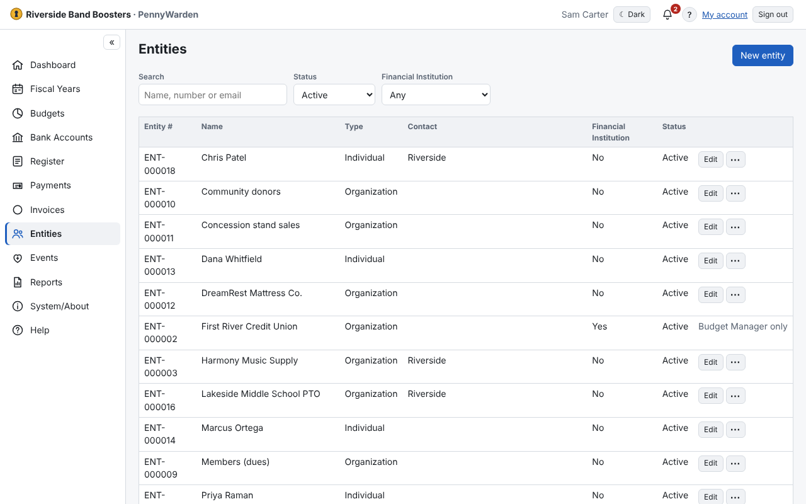

Entities are the people and organizations you pay or receive money from. Each gets a permanent number such as
**ENT-000123**, which tells apart entities with the same name.

- The register, lists and pickers use the **display name**; checks, letters, receipts, invoices and envelopes print the
  **name** and **mailing address**.
- **Inactivate** hides an entity from the pickers; its history stays and it can be restored.
- Register Users, Invoice Managers and Budget Managers maintain entities; Budget Users and Auditors look.
