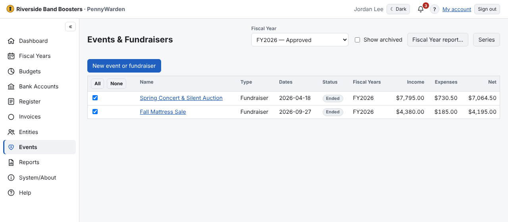

An optional module (**Events** in the menu) that gathers everything spent and received for an event, across the
register. An Administrator turns it on in [System/About → General](../system-about/optional-modules.md).

The type follows the main direction of the money:

- A **Fundraiser** raises money: it can have a **Goal**, donation buckets and the fundraising report. It needs an
  **Income** budget in each Fiscal Year it uses; Expense is optional (working a fair that another organization runs
  may have no expenses at all).
- An **Event** (a cookout, a members' dinner) spends money and shows income, expenses and net. It needs an **Expense**
  budget; Income is optional.

The year list on the Events page shows each Fiscal Year, **Upcoming** (events after the last Fiscal Year set up) and
**Earlier** (events before it that touch no Fiscal Year yet — for example last year's fair, held before PennyWarden,
until its check is linked).

Everything allocated to the chosen budgets counts. Transactions are still entered in the
[Register](../register/enter-transaction.md).
