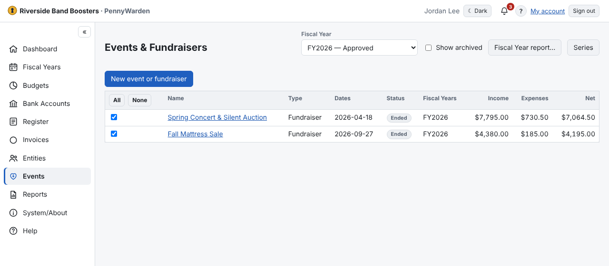

An optional module (**Events** in the menu) that gathers everything spent and received for an event, across the
register. An Administrator turns it on in [System/About → General](../system-about/optional-modules.md).

- A **Fundraiser** raises money: it can have a **Goal**, donation buckets and the fundraising report. It needs an
  **Income and an Expense** budget in each Fiscal Year it uses.
- An **Event** (a cookout, a members' dinner) shows income, expenses and net. It needs an **Expense** budget; Income is
  optional.

Everything allocated to the chosen budgets counts. Transactions are still entered in the
[Register](../register/enter-transaction.md).
