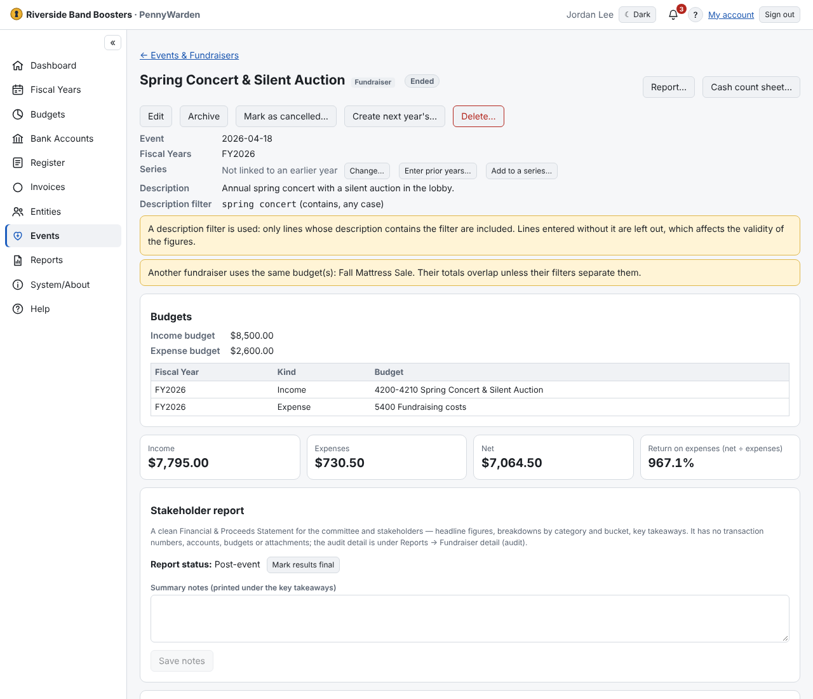

Budget Managers and Register Users can:
- use **Buckets** (with optional **categories**) to split the money by activity: *Food sales*, *Raffle*. **Manage** on a
  line assigns amounts to buckets; a bucket can hold income and expenses;
- record a **Cash float out / returned**, which keeps the cash-box float out of income and expenses;
- **Exclude this line** (with a reason) to leave a line out without changing the transaction;
- use **Charge less a credit** and **Different contributor on reports** to adjust how a line shows in the reports;
- keep flyers, permits and the signed **cash count sheet** under **Fundraiser documents** (print the sheet blank from
  **Cash count sheet…**);
- **Mark as cancelled…** / **Reinstate**, **Archive**, and **Mark results final**.
