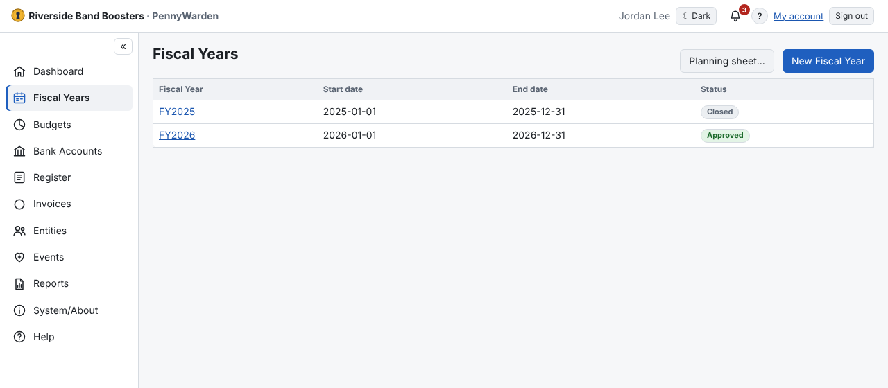

1. **Fiscal Years → New Fiscal Year**.
2. Enter the identifier (`2027` becomes **FY2027**), the start date and the end date.
3. Optional: **Copy budgets from** an earlier year. Its codes, names, types, sub-budgets and amounts become Draft
   starting values, each linked to the budget it came from. Remove any you don't want before creating the year.
4. Choose **Create**.

The new year should start the day after the previous one ends. If it leaves a **gap** or **overlaps** another year,
PennyWarden warns you and asks you to confirm; for an overlap it shows the other year's status. Overlaps are allowed for
a change of fiscal calendar — when two open years cover a transaction date, the Register asks which year to use.
