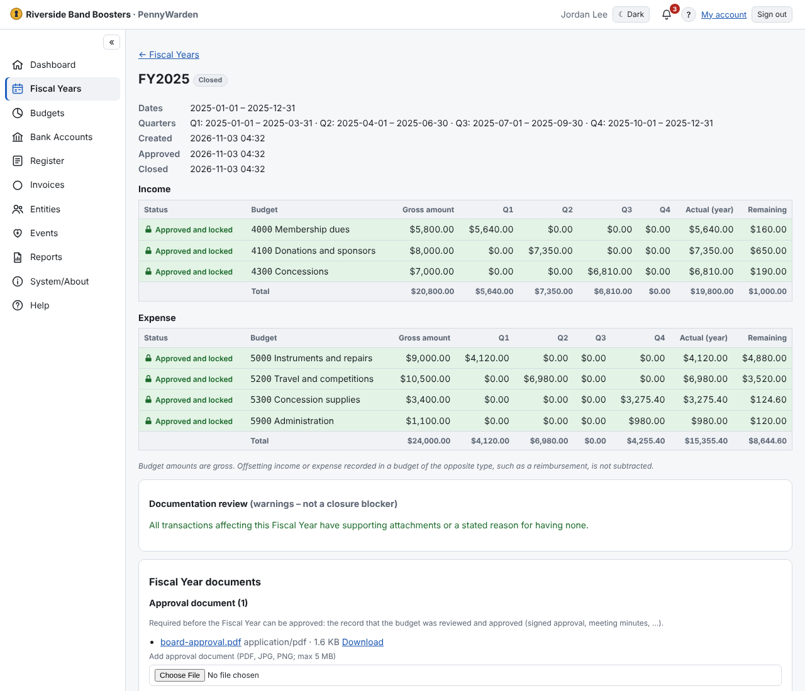

Click a year to see its Income and Expense budgets with each quarter's activity, the year's actual and what remains,
its status, its lifecycle dates, its documents, the documentation review and the closure readiness.

**Documents.** Each document is filed as:
- **Approval document** — the signed approval or the minutes. Needed before **Approve…**. If your organization produces
  none, use **Mark as no approval document** (a warning then stays on the year).
- **Audit Signoff** — needed to close the year (scan the signed audit signature page, see
  [Reports](../reports/report-list.md)).
- **Other documents** — anything else, such as the scanned Planning Sheet. **Reorder…** sets their order.

**Documentation review** lists transactions with no attachment, or marked *No attachment will be provided* without a
reason (see [Attachments](../attachments/attachments.md)). It warns; it never blocks approval or closure.
