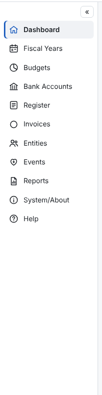

- The **menu** on the left lists the pages you may use. **«** / **»** collapses it to icons; PennyWarden remembers
  your choice.
- The **top bar** shows your name, the **☾ Dark / ☀ Light** switch, the **bell** for reminders, **My account**,
  **Sign out**, and the **?** button that opens the help page for the screen you are on.
- A **gold circle with an up arrow** next to your name means a newer version is out; click it to read what's new.
- Tables show **Edit** and a **⋯** menu with the row's other actions.
- Nothing financial is ever erased. Records are inactivated, rejected, retired, voided or (by the admin roles)
  deleted, and Auditors can still see them.
- Status is always shown in words or icons, never by color alone.
