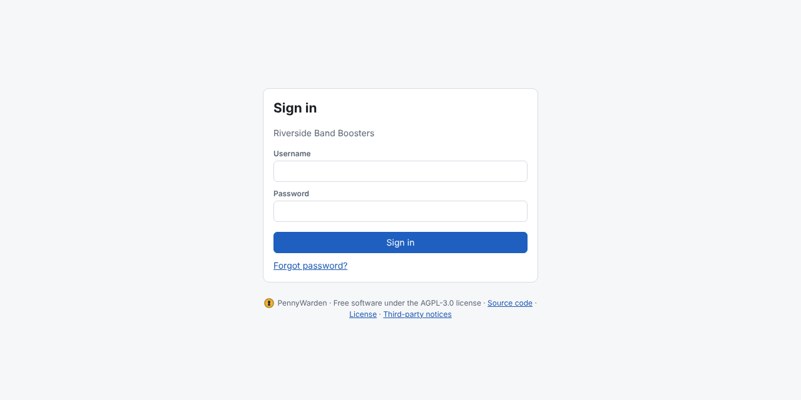

1. Enter your **username** and **password** and choose **Sign in**. If the password is refused, the field is emptied so
   you can type it again.
2. If PennyWarden asks for a **6-digit code**, open your authenticator app and type the code it shows.

**Two-step verification.** On a server everyone uses it; on a local install it is optional (**My account → Two-step
verification → Set up**). See [Two-step verification](../my-account/two-step-verification.md).

**Trust this browser for 30 days** skips the code on this computer for 30 days. Tick it only on a computer you alone
use.

**Password rules:** 12 to 128 characters, at least one letter and one digit, not your username, and different from
your current password. Each rule turns green as you meet it.

After 5 wrong passwords in a row the account is locked for 15 minutes, then longer; after 20 it is disabled until an
Administrator enables it again.
