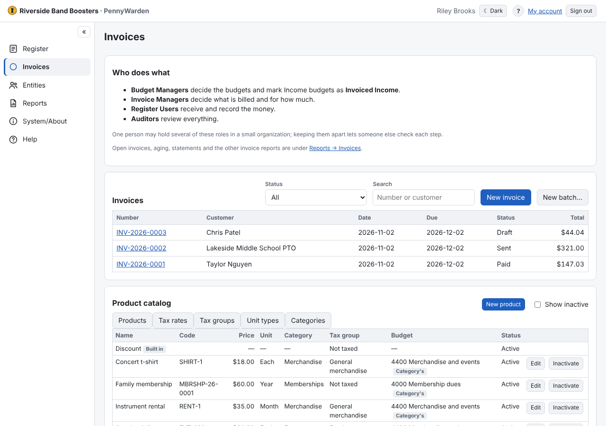

An optional module for billing members and customers. Who does what:
- the **Administrator** turns it on ([Optional modules](../system-about/optional-modules.md)), gives the **Invoice
  Manager** role and sets up numbering and the invoice PDF ([Invoices Setup](invoices-setup.md));
- a **Budget Manager** marks the [Invoiced Income budgets](../budgets/invoiced-income-budgets.md) the money goes to;
- the **Invoice Manager** keeps the product catalog and creates and sends invoices;
- a **Register User** records payments, which become deposits in the Register.

**Setting it up, in order**
1. Administrator: turn on Invoices, give the Invoice Manager role, and check [Invoices Setup](invoices-setup.md).
2. Budget Manager: mark the Invoiced Income budgets.
3. Invoice Manager: [categories](categories.md), [tax rates and tax groups](set-up-tax.md), then
   [products](add-product.md).
4. Invoice Manager: [create the first invoice](create-invoice.md).
