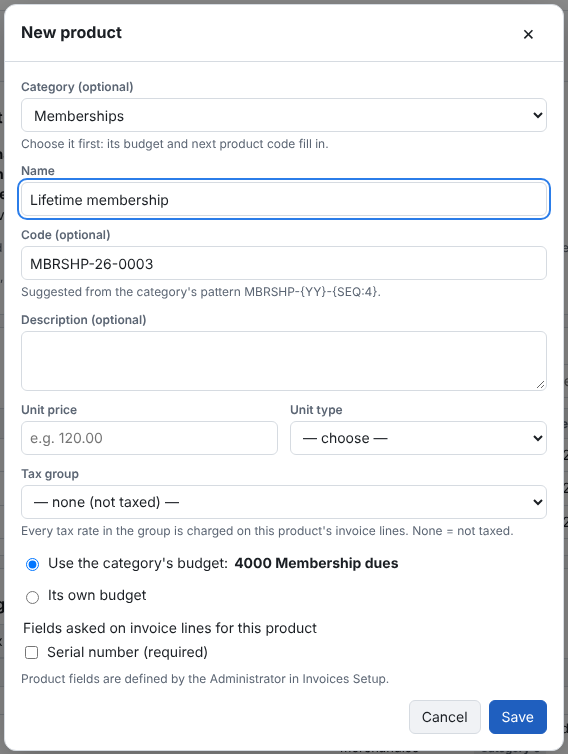

1. **Product catalog → Products → New product**.
2. Choose the **Category** first. Its next product code fills in, and its budget is offered.
3. Enter the **Name**. Keep or change the **Code** (codes are unique).
4. Optional: a **Description** — it is copied onto invoice lines with the name.
5. Enter the **Unit price** and choose the **Unit type**.
6. Choose the **Tax group**, or *None (not taxed)* ([Setting up sales tax](set-up-tax.md)).
7. Budget: **Use the category's budget**, or choose **Its own budget**. Without a category, or when the category has no
   budget, choose the budget here.
8. Optional: tick the **Fields asked on invoice lines for this product**, such as *Serial number*
   ([Custom fields](custom-fields.md)).
9. **Save**.

An invoice line copies the product's description and price when it is added, so later catalog changes never alter an
issued invoice.
