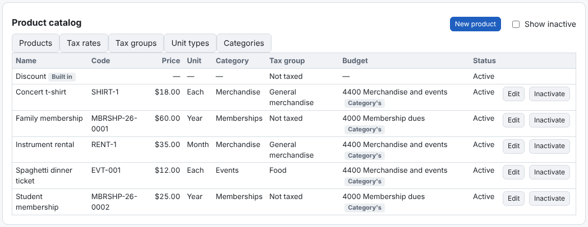

Invoices are built from the catalog, never typed by hand. On **Invoices → Product catalog** the tabs are:
- **Products** — what you bill for: price, unit, category, tax group and budget ([Adding a product](add-product.md)).
- **Tax rates** and **Tax groups** — sales tax ([Setting up sales tax](set-up-tax.md)).
- **Unit types** — Each, Hour, Month… (common ones are there already).
- **Categories** — groups of products with their own defaults ([Categories](categories.md)).

A **Discount** item is built in. Nothing is deleted: **Inactivate** what you no longer use (**Show inactive** lists it,
**Restore** brings it back). Budget Managers, Budget Users and Auditors can look at the catalog; the Administrator can't.
