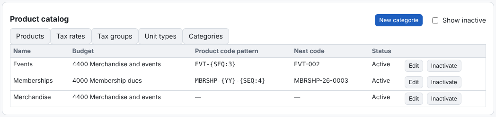
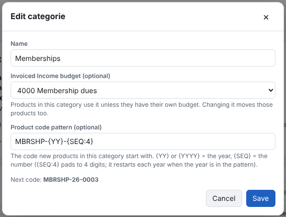

A category groups products (Memberships, Merchandise, Events) and can give them two defaults:
- **Invoiced Income budget (optional)** — products in the category use it unless they have their own budget. Changing
  it moves those products too. A category's budget can't be removed while products use it.
- **Product code pattern (optional)** — the code new products start with, for example `MBRSHP-{YY}-{SEQ:4}`.
  `{YY}` or `{YYYY}` is the year and `{SEQ}` the number (`{SEQ:4}` pads it to 4 digits). Each category counts its own
  numbers; with the year in the pattern the count starts again at 1 each year.

1. **Categories → New category** (or **Edit**).
2. Enter the name, choose the budget and type the pattern. **Next code** shows the code the next product will get.
3. **Save**.

A number is used only when a product is saved with the suggested code. If you type your own code instead, the number
stays free for the next product. A code another product already has is skipped. Changing an existing product's category
never changes its code.
