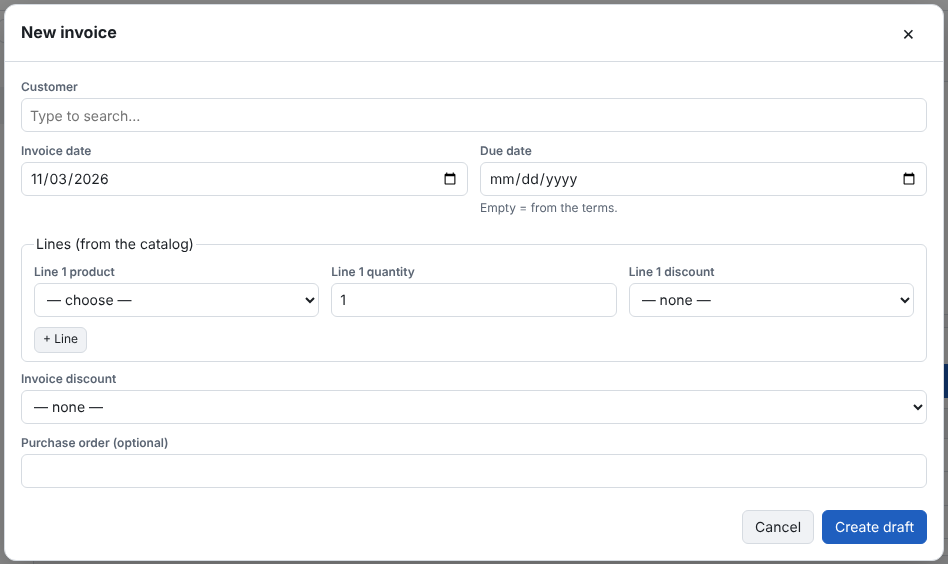

1. **Invoices → New invoice**.
2. Choose the **customer** and the **invoice date**. The **due date** follows from the terms unless you enter one.
3. Add lines: the **product** and the **quantity** for each. A line discount (amount or percent) needs a reason, which is
   printed. A product with a product field asks for it on its line.
4. Optional: an **invoice discount** (spread over the lines in proportion), the notes and the terms text, and any invoice
   fields.
5. **Save**. The draft gets its number at once; numbers are never reused.

Sales tax is worked out from each product's tax group; you don't choose it on the invoice.
