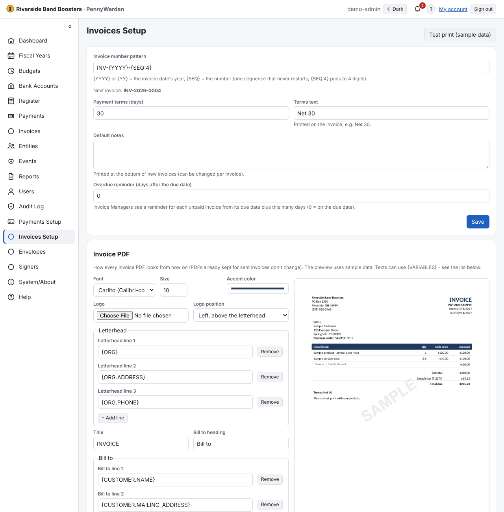

**Invoices Setup** (Administrators) — the Administrator sees sample data only, never real invoices.
- **Invoice number pattern**: `{YYYY}` or `{YY}` = the invoice date's year, `{SEQ}` = the number (one sequence that never
  restarts; `{SEQ:4}` pads to 4 digits). **Next invoice** shows the next number as you type, or why the pattern isn't
  valid.
- **Payment terms (days)**, **Terms text** and **Default notes** for new invoices.
- **Overdue reminder**: how many days after the due date Invoice Managers are reminded.
- **Email Reply-To** and **Email From name** (optional): where customers' replies to invoice and statement emails go
  (for example invoicing@…) and the sender name they see; empty uses the Email setup's. The From address is always
  the mail server's account.
- **Custom fields** — see [Custom fields](custom-fields.md).
- **Invoice PDF** — see [The invoice PDF](invoice-pdf.md).
- **Test print (sample data)** shows a whole invoice.
