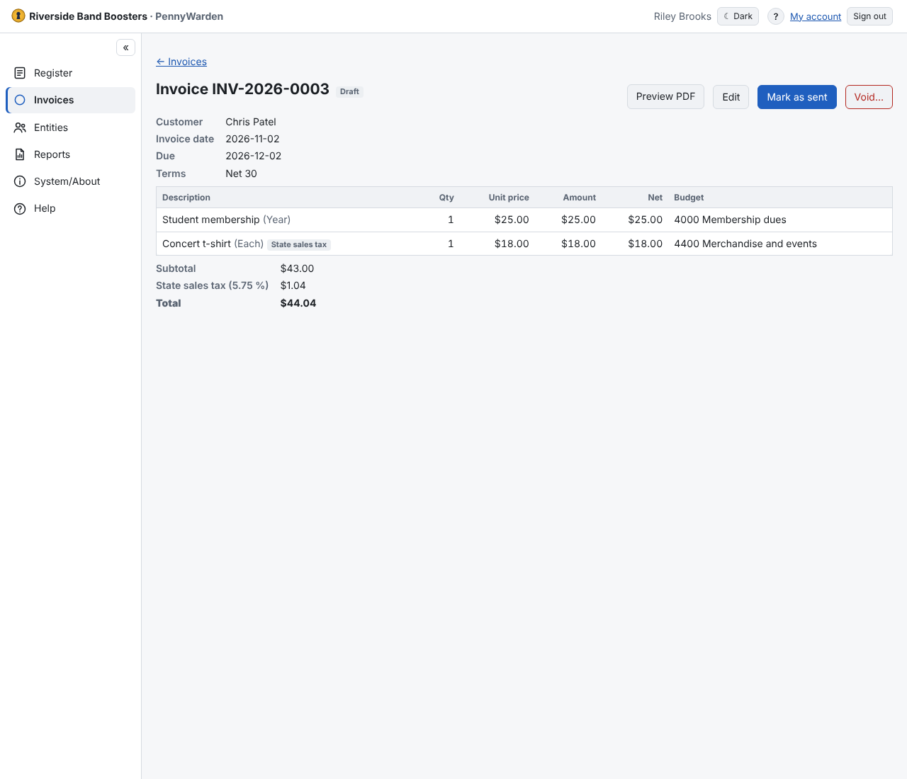

- **Preview PDF** shows the invoice as it will print (a draft is marked DRAFT).
- **Mark as sent** keeps the PDF of this version with the invoice. Send it to the customer, or use **Email…**
  ([Emailing invoices](email-invoices.md)).
- **Revise…** a sent invoice to change it: the same number with -R1, -R2…; every sent version's PDF stays.
- **Void…** an invoice entered by mistake (a reason is required). It keeps its number.
- **Request write-off…** when an open balance won't be collected; a Budget Manager approves or rejects it.

Void and write-off have no financial or budget effect.
