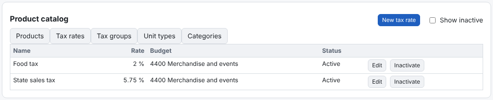
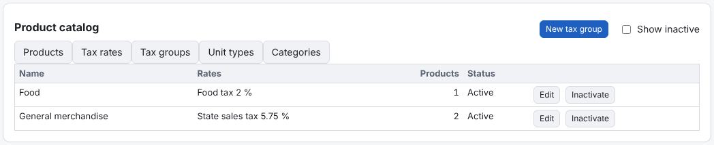
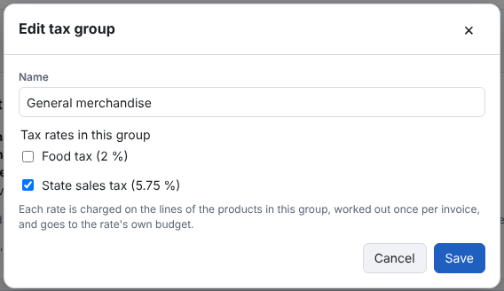

Sales tax is set up in three steps: **tax rates**, then **tax groups** that combine them, then **one tax group per
product**. Each invoice line is then charged every rate in its product's group.

**Step 1 — Tax rates**

1. **Product catalog → Tax rates → New tax rate**.
2. Enter the name (*State sales tax*), the rate in percent (`5.75`) and the **Invoiced Income budget** the tax is
   collected into.
3. **Save**. Add every rate you charge: *Hotel tax*, *Food tax*…

**Step 2 — Tax groups**

A tax group is a named set of one or more rates that apply together.
1. **Tax groups → New tax group**.
2. Enter the name and tick its rates.
3. **Save**.

A group with a single rate is fine — for example *General merchandise* = *State sales tax*.

**Step 3 — A tax group on each product**

In the product form choose the **Tax group** (see [Adding a product](add-product.md)). *None (not taxed)* is for dues,
donations and anything else that isn't taxed.

**Worked example — a hotel**

| Rate | % | Group |
|---|---|---|
| Hotel tax | 6 | Lodging |
| State tax | 5 | Lodging |
| Food tax | 2 | Food |

The product *Room night* ($100.00) uses **Lodging**; *Restaurant meal* ($30.00) uses **Food**. One night and one meal
billed together show three taxes on two lines:

| Line | Hotel tax | State tax | Food tax |
|---|---|---|---|
| Room night $100.00 | $6.00 | $5.00 | — |
| Restaurant meal $30.00 | — | — | $0.60 |

The invoice total is $130.00 + $6.00 + $5.00 + $0.60 = **$141.60**.

**How the tax is worked out**
- Each rate is charged on the lines that carry it, **after** line and invoice discounts, and rounded to the cent once
  per invoice.
- Each rate has its own total line on the invoice and on the PDF.
- When the invoice is paid, each rate's part goes to that rate's budget.
- No tax is charged on another tax.
- A [tax-exempt customer](tax-exempt-customers.md) is charged none of them.

**When something changes**
Changing a rate's percent, or a group's rates, reaches **draft** invoices and revisions when they are saved or sent.
Invoices already sent keep the tax they were sent with. An inactivated rate stops applying to drafts. Rates and groups
are inactivated, never deleted.
