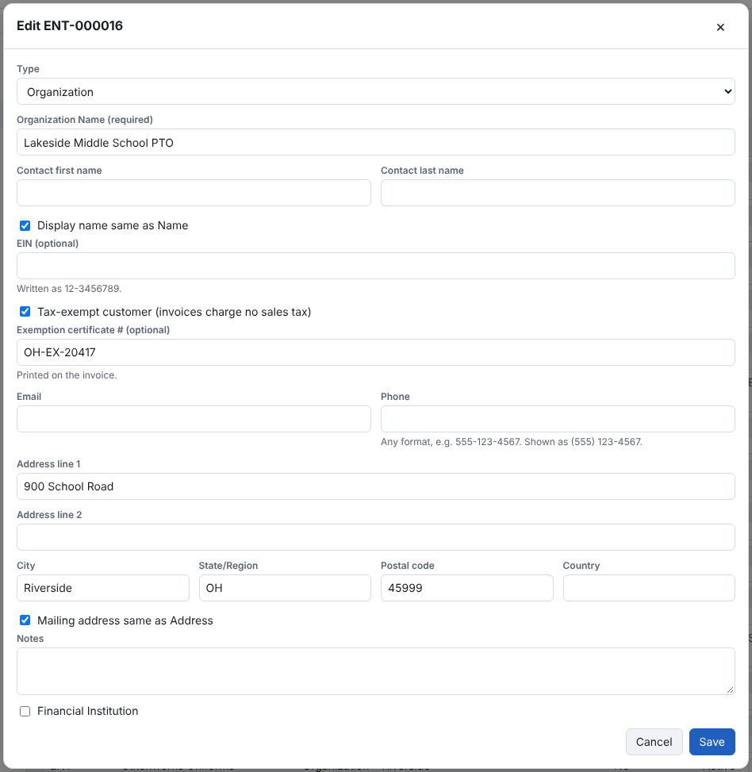

1. Open the customer under **Entities** and choose **Edit**.
2. Tick **Tax-exempt customer (invoices charge no sales tax)**.
3. Optional: enter the **Exemption certificate #** — it is printed on the invoice.
4. **Save**. The change is recorded in the Audit Log.

Invoices to the customer charge no tax on any line, and the PDF says *Tax exempt — certificate #…*. There is no
per-invoice override: to charge tax again, untick the box on the entity. Turning it on or off reaches drafts and
revisions when they are saved or sent; invoices already sent keep their tax.
