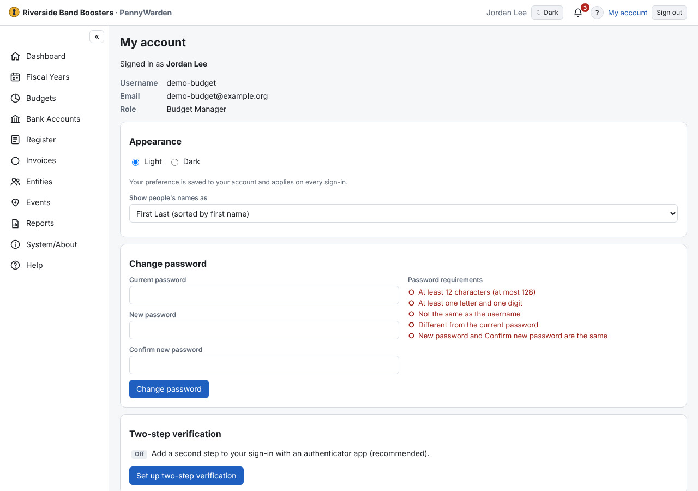

**My account** (top bar) shows your username, email and roles, and lets you:
- **Change password** — see [Changing your password](change-password.md).
- Set up or change **two-step verification**, see how many recovery codes you have left, and remove **trusted
  browsers** — see [Two-step verification](two-step-verification.md).
- Change your **security questions** (your password is needed).
- Choose **Appearance**: Light or Dark. The choice follows you to any computer you sign in from.
- **Show people's names as** *First Last* or *Last, First* — how Individuals show and sort for you.
- See the version and build (**About**), the license and the source-code links. On a local install, the update notice
  is shown here.
