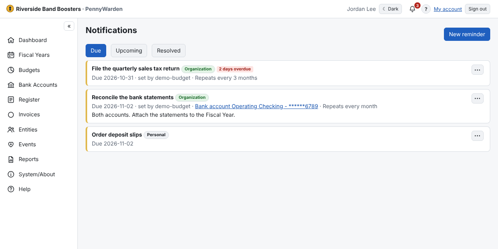

The **bell** shows how many reminders are due; click it for **Notifications** (*Due*, *Upcoming*, *Resolved*). Due
reminders also appear on the Dashboard.

1. **New reminder** (Budget Managers and Register Users).
2. Enter what, the due date, how many days before to show it, details and an optional link to a Fiscal Year, budget or
   account.
3. Budget Managers can make it for the **whole organization** and make it **repeat** (every N days, weeks, months or
   years, optionally until a date).

**Resolve** (with an optional note) clears it; a repeating one then creates the next. A resolved reminder can be
**reopened**.

## Tasks

A reminder can carry a checklist of **tasks** (up to 25) — for example *Prepare the letter*, *Receive approvals*,
*Print*, *Mail*. Add them under **Tasks** in the reminder form.

- Tick each task as it is done, in any order; the first open one is marked **Next**. Whoever can resolve the reminder
  can tick its tasks, once it is shown (set **Show days before** to start a long job early).
- Ticking the **last** task resolves the reminder (you can add a note). A repeating reminder's next one starts with
  every task unticked.
- **Resolve** with tasks still open needs a note; those tasks are shown as *skipped*. Unticking a task of a resolved
  reminder reopens it.
- **Contact:** a task can name *an organization or person* (always that entity) or *whoever holds a position* (for
  example City Clerk — the active individuals with that position when the reminder is shown). Their email, phone and
  mailing address show on the task. If nobody active holds the position, or the person was inactivated, the task
  says so: find the contact and edit the task.
- **Opens:** a task can open a report (for example **End of Year Audit**) or a page with one click; a report opens
  with its default options.
- Once a reminder is shown its own details are locked, but Budget Managers (the owner, for a personal one) can still
  change its tasks: **⋯ → Edit tasks…**.
