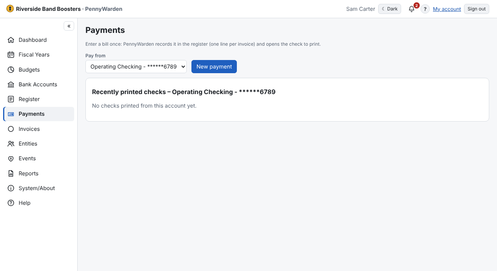

An optional module for paying bills and printing checks on pre-printed check stock.
- **Administrators** turn on **Payments module** in System/About → General, then use **Payments Setup** for check styles,
  cover letters and printing settings ([Payments Setup](payments-setup.md)).
- **Register Users** use **Payments** to enter bills and print their checks ([Printing a check](print-a-check.md)).

Copies of everything printed are attached to the transaction. The full technical guide is
[Check printing](../reference/check-printing.md).
