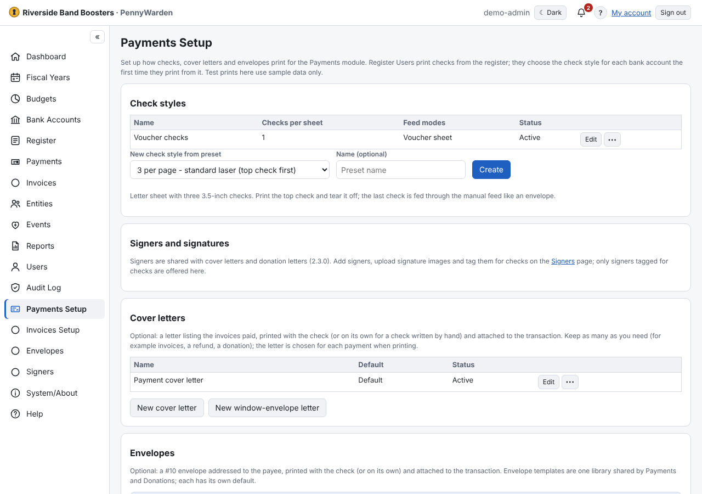

- **Check styles**: 3 per page or voucher, fonts, the default memo (with `{VARIABLES}`), the amount style.
- **Test print** on plain paper and **calibration** to move the print to match your check stock.
- **Cover letters** and **envelopes** — see [Cover letters](cover-letters.md) and
  [Envelopes and signers](../envelopes-and-signers/envelopes.md).
- Each bank account chooses its check style.

The step-by-step setup is in [Check printing](../reference/check-printing.md).
