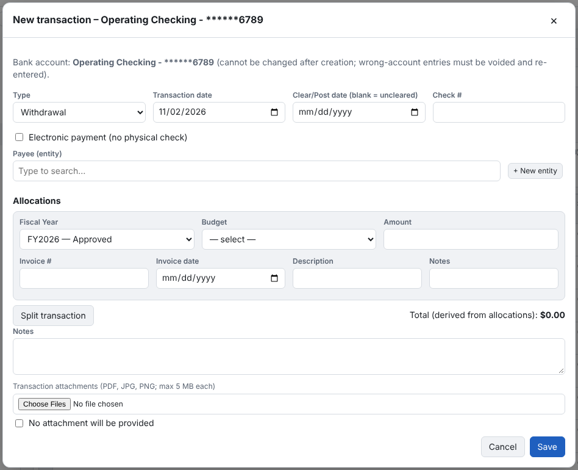

1. **New transaction**.
2. Choose **Deposit** or **Withdrawal** and the **Transaction Date** (today by default).
3. Choose the entity (type to search by name or ENT number) and, for a check, the check number.
4. Enter the description and amount, and choose the **Fiscal Year** and **Budget**. Deposits go to Income budgets,
   withdrawals to Expense budgets.
5. Leave **Clear/Post Date** empty until the bank posts it; it can't be before the transaction date.
6. Attach the receipt or invoice under **Transaction attachments**, then **Save**.

Good to know:
- **Draft Fiscal Years** take transactions like Approved ones. Closed years don't.
- **A budget from another year** asks you to confirm, and the allocation goes on the
  [Fiscal Year review](reviews-and-missing-checks.md) list.
- **No Fiscal Year covers the date:** PennyWarden warns you and names the closest year without choosing it for you.
- **Two years cover the date** (an overlap): you must choose the year.
- **Possible duplicate:** the same account, date, type, amount and entity asks *Save anyway?*.
- **Check numbers** can be used only once per account.
- **Electronic payment (no physical check)** for ACH, bill pay, debit card, wire or a vendor portal: choose the method and
  whether the number is a **check # from our sequence** or a **payment reference** (which never counts as a check).
- **Budget 0** is a protected system budget for exceptional records such as a zero-dollar VOID check.
