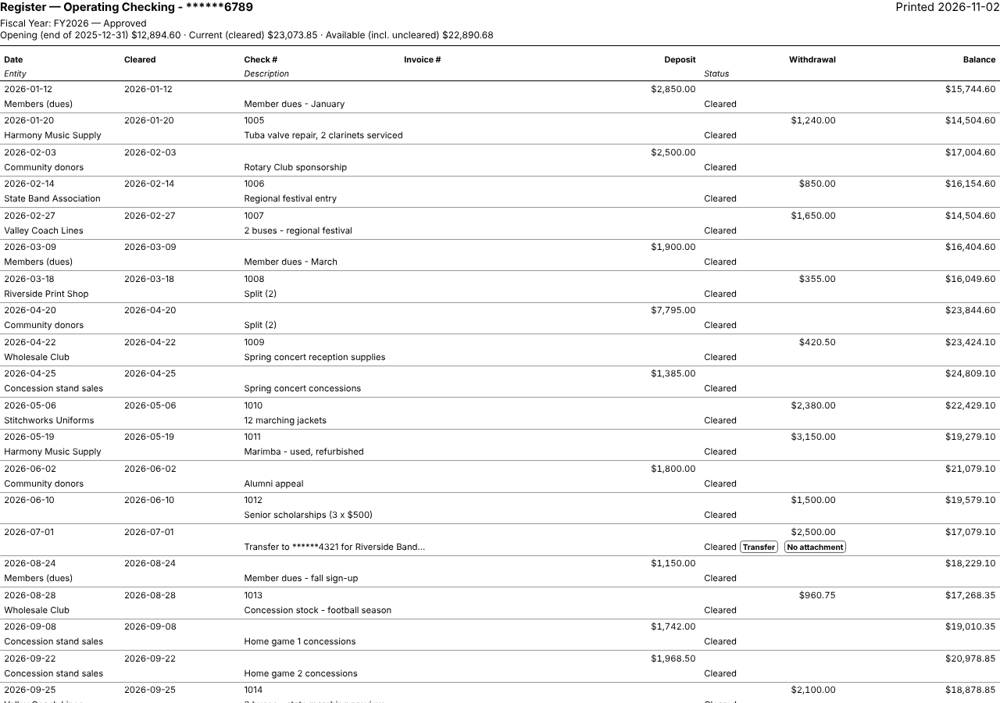

1. Set the filters to what you want on paper — a budget, a date range, uncleared items…
2. Use your browser's or the app's **Print** (Ctrl+P / ⌘P).

The printout is portrait. The top lines show the bank account and the date printed, the filters that are applied (the
Fiscal Year is always listed) and the balances. Each transaction takes two lines: the dates, check and invoice numbers,
amounts and balance first, then the entity, description and status. A long entity name or description is shortened and
ends in "…". The filter boxes, balance tiles, opened details and the 📎 column are not printed.
