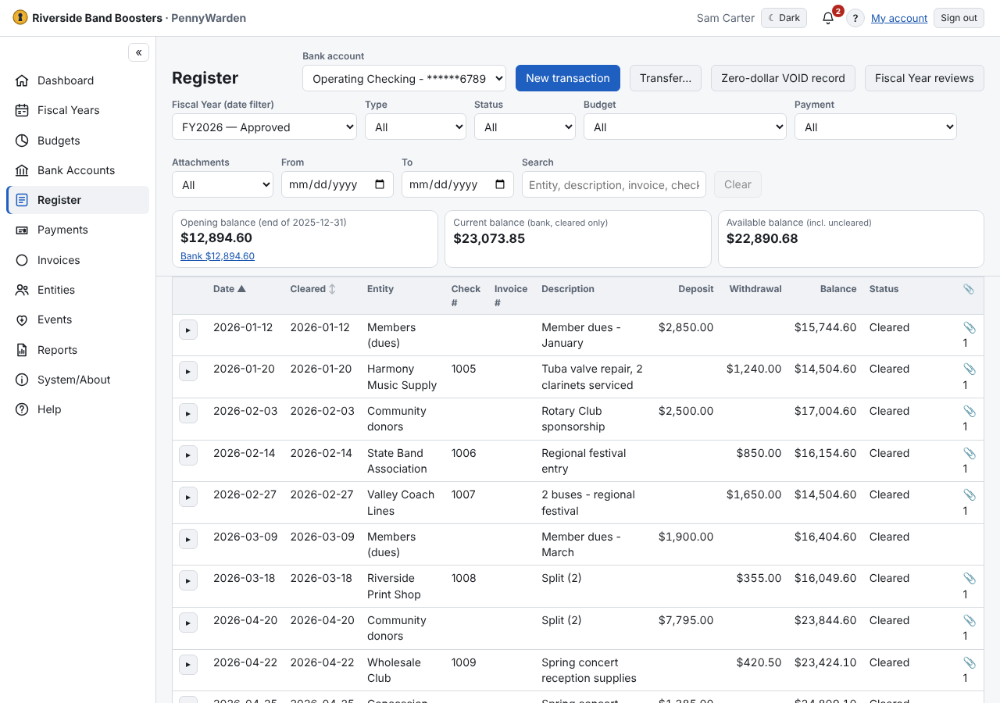
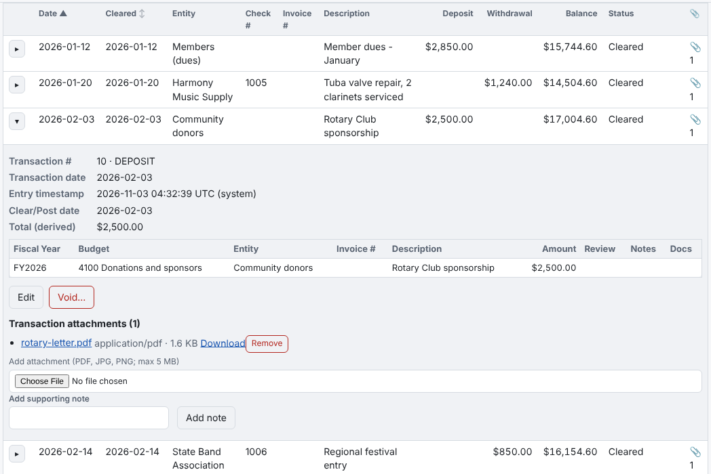

Each register account has one continuous register for its whole life. The Fiscal Year choice only filters it by
transaction date.

- Choose the **account** at the top (it opens on the Primary account) and the **Fiscal Year** (the current one by
  default, or *All dates*).
- The balances at the top: **Opening balance** for the year (with **Bank $…** and the outstanding items that make up the
  difference), **Current** and **Available** for an open year, **Ending balance** for a closed year or a *To* date.
- **Filters:** deposit or withdrawal; cleared, uncleared or VOID; date range; **Budget**; **Payment** (checks,
  electronic payments, no check number); **Attachments** (*Yes*, *Missing*, *Marked*); and search by entity,
  description, invoice number, check number or amount. **Clear** puts them back.
- Click **Date** or **Cleared** to sort; click again to reverse. Sorted by Cleared, the balance column becomes the
  **Cleared balance** (what the bank statement shows). Uncleared items stay together as outstanding; a voided
  transaction that never cleared sits at its own transaction date. **Reset to default** goes back to Date, oldest first.
- Click **▸** on a row to see its allocations, notes, attachments, history and actions.

