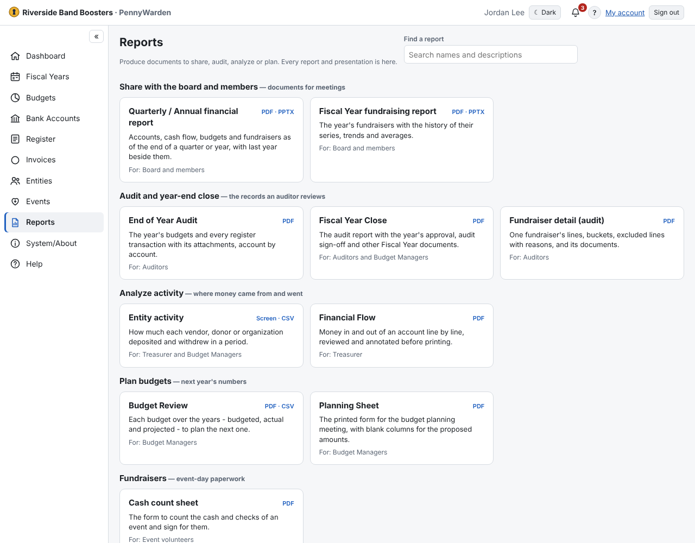

1. Open **Reports**. The catalog lists everything you may run, grouped by purpose.
2. Type in **Find a report**, or pick one from **Recently run** to run it again with the same choices.
3. Choose the options (Fiscal Year, dates, accounts…) and **Open PDF**, **Download PDF** and, where it makes sense,
   **Download CSV** or a presentation (`.pptx`).

Each report has its own page you can bookmark. An Administrator can regroup the catalog under **System/About → Report
settings**; that changes only where a report is listed, not who may run it. Reports use your organization's
[branding](../system-about/branding.md).
