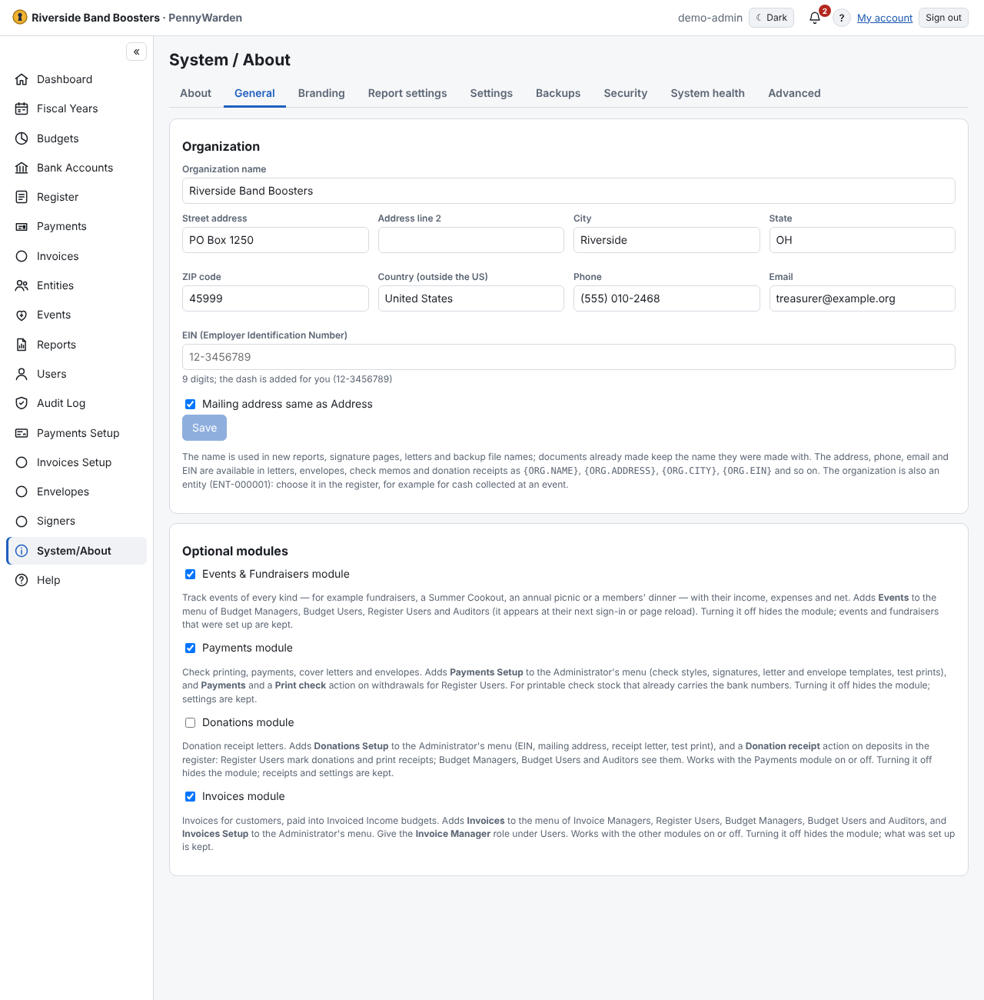

Administrators look after the installation here; Auditors and financial users see parts of it read-only. Each tab has
its own address.
- **About** — version and build, license, the update check (**Check now**).
- **General** — the **organization** (name, address, phone, email, EIN) and the **Optional modules**.
- **Settings** — every setting in effect and where it comes from. On a server, security and session settings can be
  changed here; **Update channel** chooses which releases the update notice reports; **Email** sets up the mail server.
- **Branding** — see [Branding](branding.md).
- **Report settings** — how the Reports catalog is grouped.
- **Backups** — see [Backup and restore](../backup-and-restore/backups.md).
- **Security** — the security overview (HTTPS, two-step verification, last backup, locked accounts, people holding
  several financial roles) and the **signed-in sessions**.
- **System health** — sizes, free disk space, shared attachments, a database check, and **Download diagnostics** (no
  financial data, passwords or keys).
- **Advanced** — **maintenance mode** (only Administrators can change anything, with a message for everyone) and
  **Reinitialize** (start again with the same users, after a safety backup).
