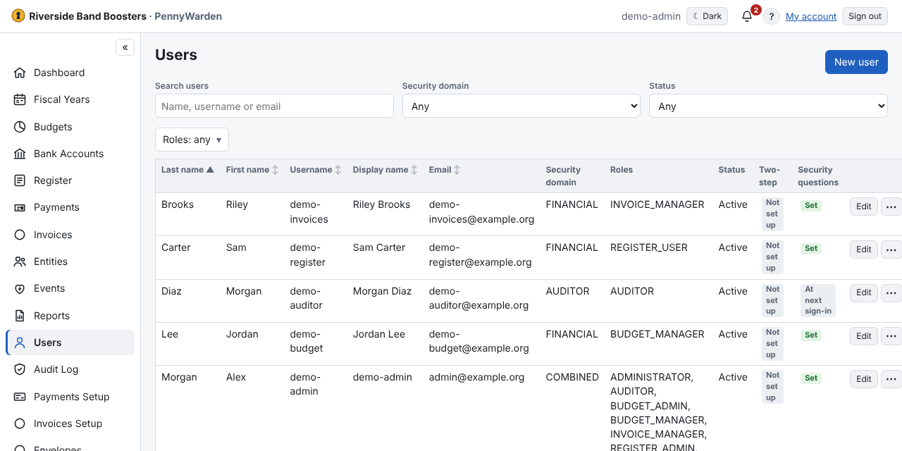

Administrators (and, read-only, Auditors) manage accounts here.
1. **New user**: username, first and last name, display name, email, security domain and roles, and an **Initial
   password**.
2. The user signs in, chooses a new password and security questions (and on a server sets up two-step verification).

- Search and filter by **Roles**, **Security domain** and **Status**; click a heading to sort.
- **⋯** actions: reset password, **Reset two-step verification** (tick **Possible compromise** if the key may be
  exposed), **Reset security questions**, enable a disabled account, deactivate.
- On a server, an Administrator can't change their own roles or deactivate themselves — keep at least two
  Administrators.
- Every sign-in, password change, role change and reset is recorded in the Audit Log.
